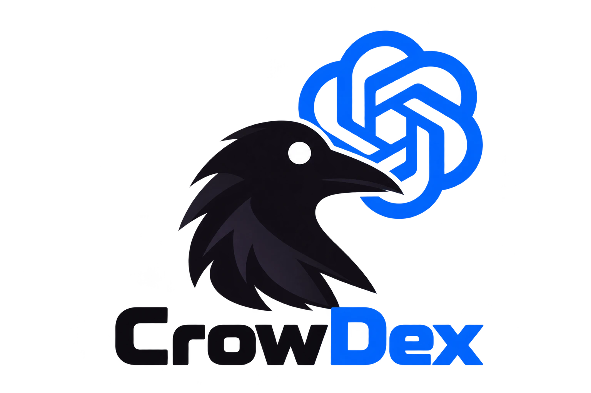

<p align="center">
  
</p>

# codex-crow

Plugin `crow` do Codex: as mesmas skills do plugin `crow` do Claude Code, para
eu continuar no Codex quando os tokens do Claude acabam, no mesmo projeto e do
mesmo ponto.

**Autor:** Caique Rechi Mehret

> **A fonte é o [claude-crow](https://github.com/CaiqueRechi/claude-crow).**
> As skills são escritas lá e adaptadas para cá. Correção feita só aqui some na
> próxima versão — corrija no `claude-crow`.

| Chamada | Skill | Quando roda |
| --- | --- | --- |
| `$crow:context` | prepara o projeto para continuar em outro modelo, ferramenta ou chat | só quando eu chamo — e é a primeira a rodar num projeto |
| `$crow:conventions` | as minhas convenções de trabalho | sozinha, sempre que o agente for escrever código, criar branch ou commitar |
| `$crow:analyst` | analista de requisitos | só quando eu chamo |
| `$crow:develop` | codifica o que o analyst documentou, fase por fase | só quando eu chamo |
| `$crow:build` | sobe o projeto num ambiente Docker local para eu testar | só quando eu chamo |
| `$crow:security-validation` | analista de segurança defensiva | só quando eu chamo |

A ordem num projeto novo: `context` → `analyst` → `develop` → `build` →
`security-validation`. A `conventions` vale o tempo todo. No Codex, digitar `@`
também lista o plugin e as skills dele.

O que cada skill faz e como usar está na documentação do `claude-crow`
([docs/](https://github.com/CaiqueRechi/claude-crow/tree/main/docs)) — o
comportamento é o mesmo; só a chamada muda de `/crow:` para `$crow:`.

## O que muda em relação ao Claude Code

As skills chegam ao mesmo resultado nas duas ferramentas: mesmas regras, mesma
ordem, mesmos arquivos entregues. Onde o Codex não tem o recurso, a forma se
adapta:

| No Claude Code | No Codex |
| --- | --- |
| `/crow:<skill>` | `$crow:<skill>` |
| `$ARGUMENTS` | o que eu escrevi depois de `$crow:<skill>` na mensagem |
| perguntas da `analyst` com botões (`AskUserQuestion`) | a ferramenta de pergunta do Codex quando houver; senão, opções numeradas no texto |
| `disable-model-invocation: true` | `agents/openai.yaml` com `allow_implicit_invocation: false` — a skill só roda quando chamada |
| `argument-hint` | não existe no Codex; removido |
| `version` e `language` no frontmatter | dentro de `metadata`, único campo extra que o Codex aceita |

Tudo o mais é cópia do texto original.

## Instalação

O repositório é um marketplace do Codex com o plugin dentro. Pelo terminal:

```bash
codex plugin marketplace add CaiqueRechi/codex-crow
```

Depois instale o `crow` pelo navegador de plugins — `/plugins` no Codex CLI,
ou o diretório de plugins no app — e abra uma conversa nova, que é quando o
Codex carrega as skills.

Para usar um clone local, passe o caminho da pasta no lugar de
`CaiqueRechi/codex-crow`.

### Vindo do marketplace rm-skill-codex

Remova a referência antiga, adicione o marketplace novo e reinstale o plugin:

```bash
codex plugin marketplace remove rm-skill-codex
codex plugin marketplace add CaiqueRechi/codex-crow
codex plugin add crow@codex-crow
```

Depois abra uma conversa nova, que é quando o Codex recarrega as skills. O
plugin continua se chamando `crow`; só o repositório e o marketplace mudaram
para `codex-crow`.

### Vindo do rm-skill-codex 1.x

Até a 1.1.0 o repositório era só a skill das convenções, clonada em
`~/.codex/skills/rm-skill-codex`. Apague essa pasta depois de instalar o
plugin: se ficar, as convenções carregam duas vezes, e um `git pull` nela
traria esta estrutura nova para um lugar onde o Codex não a lê como plugin.

### Instalação por release

As [Releases](https://github.com/CaiqueRechi/codex-crow/releases) oferecem
um ZIP com o marketplace e o checksum SHA-256. Baixe os dois arquivos da versão
desejada, valide o checksum, extraia e adicione a pasta `codex-crow`
extraída como marketplace.

No Linux:

```bash
sha256sum -c crow-v2.1.0.zip.sha256
unzip crow-v2.1.0.zip -d ~/plugins
codex plugin marketplace add ~/plugins/codex-crow
```

No PowerShell, compare o hash calculado com o valor do arquivo `.sha256` antes
de extrair:

```powershell
Get-FileHash .\crow-v2.1.0.zip -Algorithm SHA256
Expand-Archive .\crow-v2.1.0.zip -DestinationPath "$HOME\plugins"
codex plugin marketplace add "$HOME\plugins\codex-crow"
```

## Estrutura

| Caminho | Para quê |
| --- | --- |
| `.agents/plugins/marketplace.json` | o marketplace `codex-crow`, com o plugin `crow` |
| `plugins/crow/.codex-plugin/plugin.json` | o manifesto do plugin |
| `plugins/crow/skills/<nome>/SKILL.md` | cada skill; o nome da pasta tem de bater com o `name:` |
| `plugins/crow/skills/<nome>/agents/openai.yaml` | nome na interface e se a skill pode rodar sozinha |

O `.gitattributes` força LF: o Codex só reconhece o frontmatter de um
`SKILL.md` que começa com `---` seguido de LF, e um clone no Windows com
`core.autocrlf` entregaria CRLF.

## Releases

A versão fica em [VERSION](VERSION) e é **a mesma do `crow` do Claude Code**: a
mesma versão nas duas ferramentas é o mesmo conteúdo. O `version` de
`plugin.json` tem de ser igual — é ele que o Codex lê para saber se há
atualização — e o pacote falha se os dois divergirem.

A 2.0.0 é a exceção: foi montada à mão a partir do `crow` 1.0.1 do Claude Code,
antes de ele subir para a 2.0.0. A partir daí, as duas andam juntas.

Todo pull request valida a estrutura e a criação do ZIP. Quando uma alteração
entra na `main` com uma versão ainda não publicada, o workflow cria:

- a tag `crow-vX.Y.Z`;
- a Release com notas geradas a partir dos commits;
- o pacote `crow-vX.Y.Z.zip`;
- o checksum `crow-vX.Y.Z.zip.sha256`.

As tags `v1.0.0` e `v1.1.0` são da skill avulsa, antes de virar plugin; por
isso as releases do plugin usam o prefixo `crow-`, como no `claude-crow`.

## Verificação

[docs/testing.md](docs/testing.md) registra o que foi validado nesta versão e o
roteiro do teste manual no Codex.

## O que entra aqui

Nada é escrito direto aqui: tudo vem do `claude-crow`. Preferência minha
entra lá, nas convenções; detalhe de uma base específica pertence ao
`AGENTS.md` daquele repositório.
