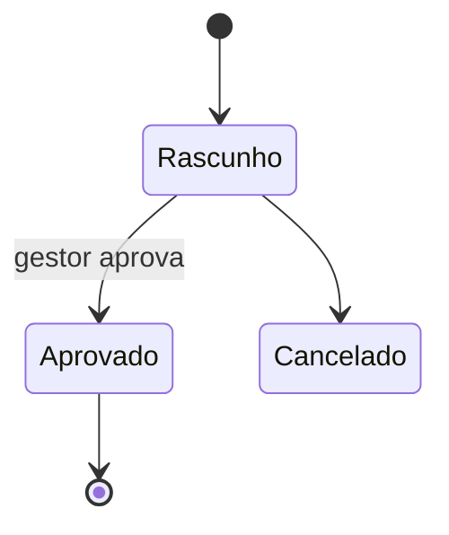
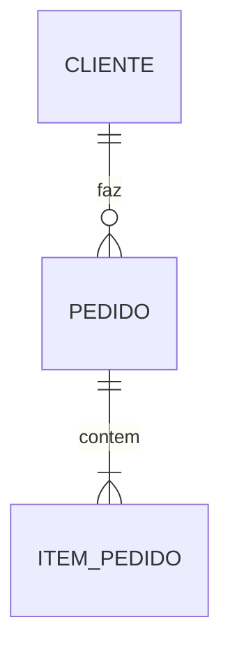
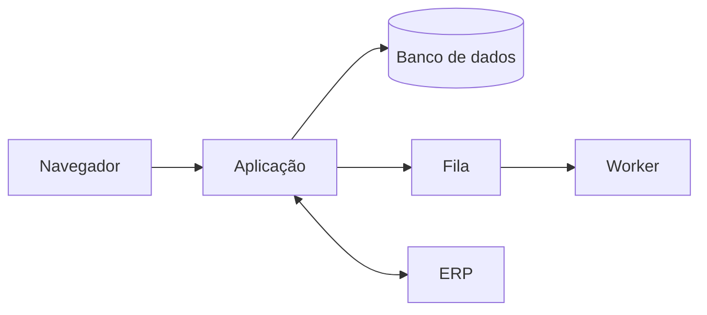
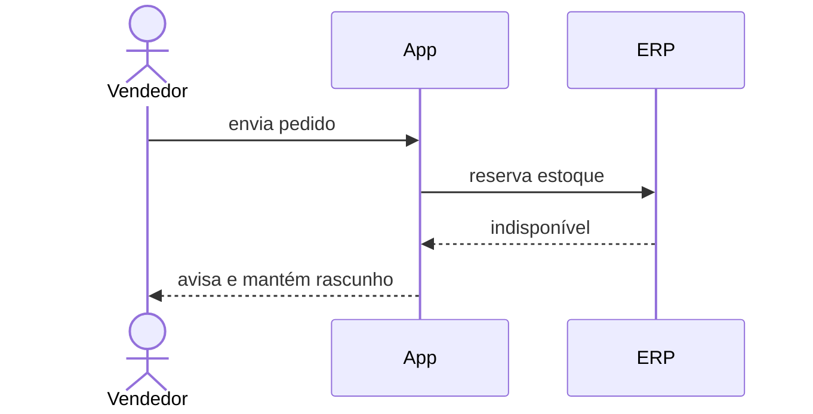

# Document template

Fill every section, in the order below, in the language of the conversation
(translate the headings if it is not Portuguese). Replace the guidance in
italics with content. A section with nothing to say keeps its heading and says
"Não se aplica — <the reason he gave>".

Identifiers are stable: once `RN-03` exists it keeps that number when the
document is updated, even if a rule before it is removed. Every `RF` cites the
`RN` it implements, so a rule change shows which requirements it touches.

Diagrams are Mermaid, so they render on GitHub and in most editors. Keep each
one about the request, not a generic picture of the stack.

---

~~~~markdown
# <Nome da solicitação>

| | |
| --- | --- |
| Data | <AAAA-MM-DD> |
| Solicitante | <quem pediu / quem aprova> |
| Cobertura do levantamento | <N>% — <M> decisões em aberto |
| Status | Em levantamento · Levantamento concluído |

## 1. Resumo

*Três a cinco linhas: o problema, o que será construído e o resultado esperado.
Alguém que leia só esta seção sabe do que se trata.*

### 1.1 Objetivos

*Lista curta, cada objetivo com a métrica de sucesso e a meta (área 3.5).*

### 1.2 Situação atual

*Como é feito hoje e o que precisa ser preservado da solução atual.*

## 2. Partes interessadas e usuários

| Persona | Quantidade | Precisa de | Pode | Não pode |
| --- | --- | --- | --- | --- |

*Quem aprova escopo e aceita a entrega. Contexto de uso (dispositivo, local,
horário).*

## 3. Modelo de negócio

*Valor gerado, quem paga e como, planos e limites, escala do negócio hoje e em
dois anos. Para sistema interno: centro de custo e ganho esperado.*

## 4. Regras de negócio

### RN-01 — <nome curto>

- **Regra:** *enunciado preciso*
- **Exemplo:** *caso concreto com valores*
- **Exceção:** *quando não se aplica e o que acontece*
- **Responsável pela regra:** *quem pode alterá-la*

*Inclua aqui cálculos (fórmula, arredondamento, impostos), ciclo de vida das
entidades e aprovações.*

### 4.x Ciclo de vida

## 5. Requisitos funcionais

### RF-01 — <nome curto>

- **Persona:** *quem usa*
- **Descrição:** *o que o sistema faz*
- **Regras:** RN-01, RN-04
- **Critérios de aceite:**
  - *Dado … quando … então …*
- **Prioridade:** MVP · Fase 2 · …

## 6. Requisitos não funcionais

| ID | Categoria | Requisito | Medida |
| --- | --- | --- | --- |
| RNF-01 | Desempenho | *operação* | *≤ 2 s para 50 usuários simultâneos* |

*Todo RNF tem número ou critério verificável. Cubra desempenho, concorrência,
disponibilidade, escalabilidade, segurança (autenticação, autorização,
proteção contra bots, dados sensíveis), conformidade (LGPD, fiscal),
acessibilidade e idioma.*

## 7. Modelo de domínio e dados

### 7.1 Entidades

| Entidade | Atributos principais | Origem | Volume (dia / 5 anos) |
| --- | --- | --- | --- |

### 7.2 Relacionamentos

### 7.3 Histórico, retenção e migração

*O que é auditado, por quanto tempo cada dado é mantido e com que base legal,
o que é excluído ou anonimizado, e os dados existentes a migrar (origem,
qualidade, volume).*

## 8. Arquitetura

### 8.1 Visão geral

*Estilo arquitetural e o porquê. Cada componente e sua responsabilidade.
O que roda no navegador e o que fica no servidor, e por quê.*

### 8.2 Tecnologias

| Camada | Tecnologia | Motivo |
| --- | --- | --- |

*Inclua o que é obrigatório, o que foi descartado e por quê.*

### 8.3 Integrações

| Sistema | Direção | Gatilho | Contrato | Se falhar |
| --- | --- | --- | --- | --- |

*Limites de chamada, custos e quem detém as credenciais.*

### 8.4 Multiempresa, ambientes e deploy

*Separação de dados entre empresas, ambientes existentes e quem usa cada um,
como uma versão chega à produção e como é revertida.*

## 9. Fluxos principais

*Um diagrama de sequência para cada fluxo crítico, com o caminho de erro.*

## 10. Gargalos, riscos e mitigações

| Risco | Onde | Probabilidade | Impacto | Mitigação |
| --- | --- | --- | --- | --- |

*Picos de uso, operações pesadas, pontos únicos de falha, dependências de
terceiros e o que ainda não se sabe.*

## 11. Escopo e fases

- **MVP:** *RF-xx…*
- **Fase 2:** *…*
- **Fora do escopo:** *o que explicitamente não faz parte*

## 12. Engenharia e operação

*Equipe, repositório e processo (por padrão, as convenções de `$crow:conventions`),
testes esperados, CI/CD, onde fica a documentação, monitoramento e alertas,
backup e tempo de restauração, suporte, treinamento e implantação.*

## 13. Restrições

*Prazo, orçamento de construção e de operação, restrições organizacionais.*

## 14. Aceite

*Como cada fluxo principal é validado, dados e cenários de teste reais, quem
assina o aceite e com base em quê.*

## 15. Decisões em aberto

| # | Decisão | Área | Responsável | Prazo | Impacto se atrasar |
| --- | --- | --- | --- | --- | --- |

*Itens adiados e, se ele pediu para fechar antes dos 100%, os itens não
discutidos, marcados como tal.*

## 16. Glossário

| Termo | Significado |
| --- | --- |
~~~~
