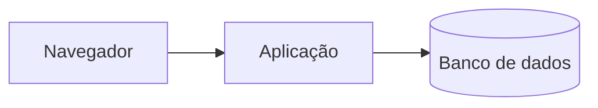
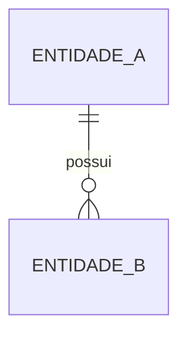
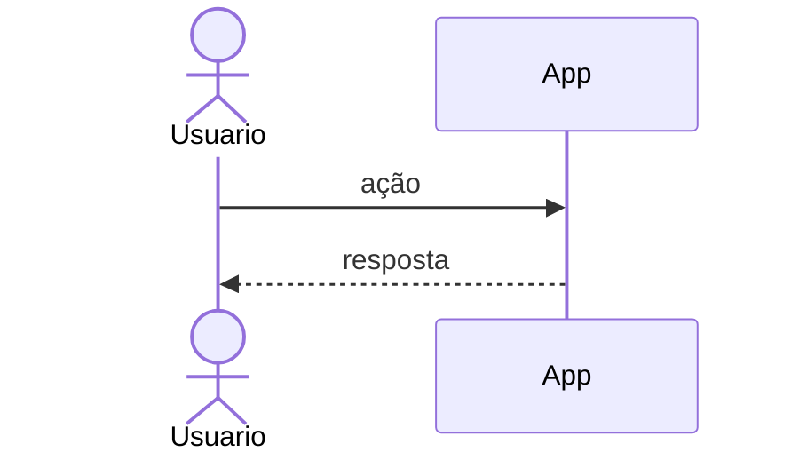

# Arquitetura — {{PROJETO}}

> Atualizado em {{AAAA-MM-DD}} por {{ID_DO_AGENTE}}. Fora do git.

## Visão geral

*Estilo arquitetural (monólito, monólito modular, serviços) e por quê.*

## Componentes

| Componente | Responsabilidade | Onde está no código |
| --- | --- | --- |

## Onde cada parte roda

*O que fica no navegador e o que fica no servidor, e por quê. Regra de
negócio, autorização e validação ficam no servidor.*

## Modelo de dados

*Entidades principais, volumes esperados, o que é auditado e por quanto tempo
cada dado é mantido.*

## Integrações

| Sistema | Direção | Gatilho | Contrato | Se falhar |
| --- | --- | --- | --- | --- |

## Segurança

*Autenticação, modelo de autorização, proteção contra bots, dados sensíveis,
segredos e onde ficam.*

## Desempenho e cache

*O que tem cache, com que chave e como é invalidado; operações pesadas e como
são tratadas.*

## Ambientes e deploy

*Ambientes existentes, como uma versão chega à produção e como é revertida.*

## Fluxos críticos

